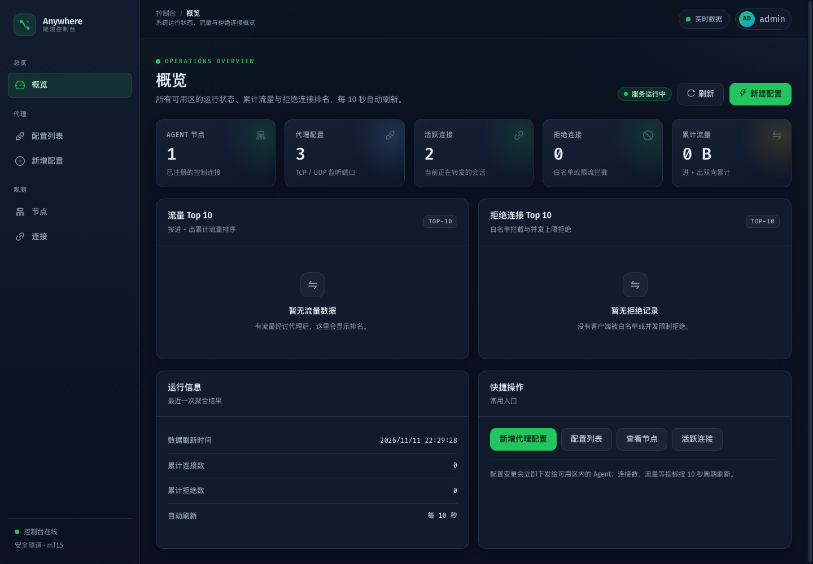
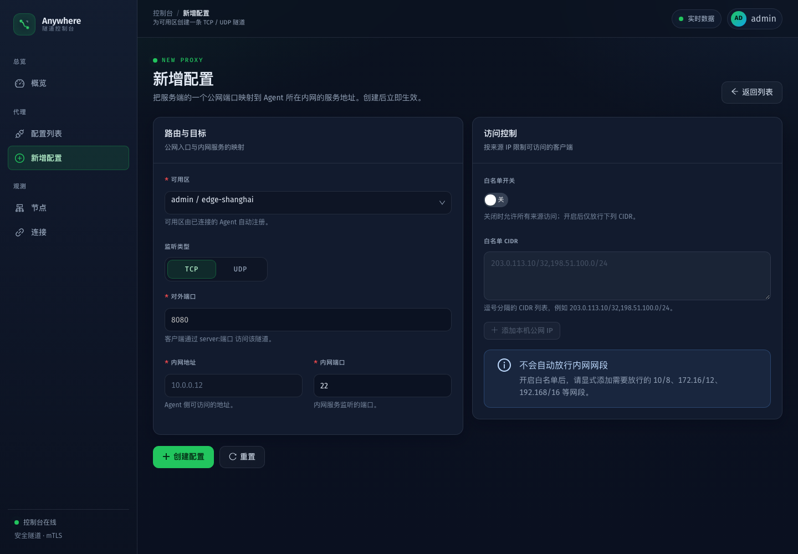
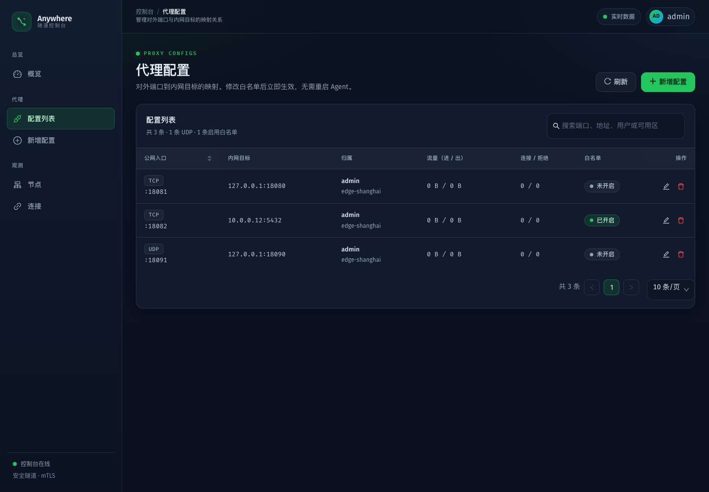
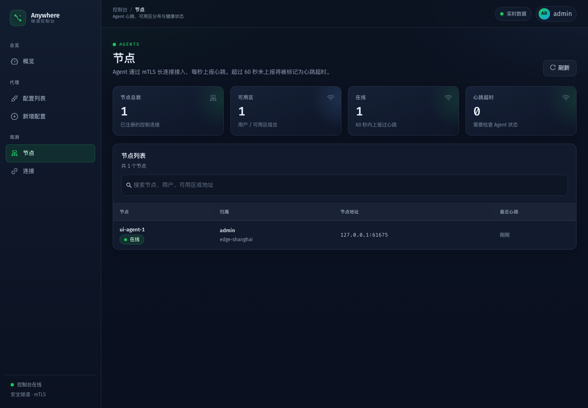
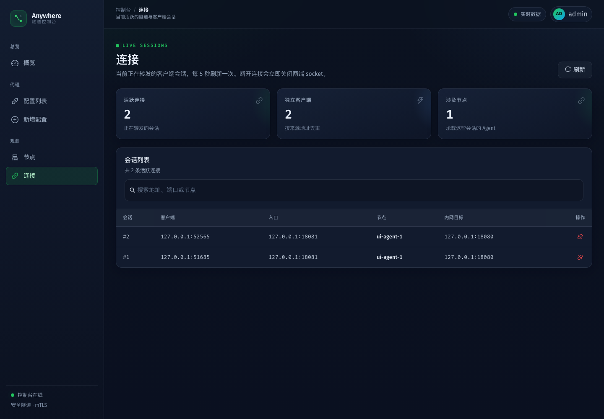

## Anywhere

- [Anywhere](#anywhere)

  - [是什么](#是什么)
  - [特性](#特性)
    - [功能特性](#功能特性)
    - [安全特性](#安全特性)
  - [基础概念](#基础概念)
    - [Agent 端](#agent-端)
    - [可用区](#可用区)
    - [Server 端](#server-端)
  - [功能截图](#功能截图)
  - [安装](#安装)

### 是什么

Anywhere 是一个内网穿透工具, 类似 [ngrok](https://github.com/inconshreveable/ngrok).  
 相比 Ngrok, Anywhere 增强了可视化管理和高可用功能, 使得使用者可以和方便的对内网穿透进行配置.

### 特性

#### 功能特性

- TCP/UDP 穿透.
- 全功能的图形化配置管理页面, 添加/删除穿透配置, 节点状态查看, 穿透连接管理.
- 多可用区高可用, 同一可用区内网中可以同时运行多个 Agent, 单个 Agent 崩溃后不影响功能使用.
- 流量统计等其他功能

#### 安全特性

- 动态密码+HTTPS 方式登陆管理页面
- Server/Agent 使用 TLS 认证
- 穿透支持 IP 白名单,不在白名单不允许连接.

### 基础概念

#### Agent 端

内网环境中的机器,通常是位于家中/公司中等没有公网 IP 的环境.  
Agent 端运行的程序与 Server 端程序维持长连接(管理连接, 用于 Server 端下发穿透指令)

#### 可用区

网络区域的抽象概念,比如: 家中/公司. 每个可用区必须运行至少一个 Agent 才能提供到此可用区的穿透功能.

#### Server 端

公网 IP 机器(虚拟机),提供广域网的入口.
添加一个新的穿透配置时, 您需要选择 Server 端口+可用区+内网地址, 添加完成后, 所有流入 Server 此端口的流量都会转发到指定可用区的指定地址.

### 功能截图











### 安装

#### 从源码构建

依赖: Go 1.22+, Node.js 20+, OpenSSL 1.1.1+, `protoc`(仅在修改协议时需要). 前端使用 Vite + TypeScript.

```shell script
make build        # 构建 bin/anywhered 与 bin/anywhere
make newkey       # 生成 CA / server / client / http 证书(SAN 包含 anywhere.local, localhost, 127.0.0.1)
make ui           # npm ci + vite build，产物输出到 ./static
make test         # 单元测试
make race         # 竞态检测
make docker_test  # 容器端到端测试(需要 Docker)
```

容器端到端测试会构建 Linux 二进制与 server/agent 镜像，启动 3 个 Agent、HTTP/UDP/MySQL
目标服务，通过登录后的 HTTP API 创建代理配置，并验证 TCP、UDP、MySQL 与 Console 静态资源。
失败时可设置 `KEEP=1` 保留容器现场，`make docker_test_clean` 清理。

也可以从 [Actions](https://github.com/cntechpower/anywhere/actions?query=branch%3Amaster) 的 Artifacts 下载构建产物, 但请务必重新执行 `make newkey` 生成自己的证书, 不要使用仓库或安装包内的示例证书.

#### Server 安装与启动

```shell script
mkdir -p /usr/local/anywhere
tar -xvf anywhere-server.tar.gz -C /usr/local/anywhere
cd /usr/local/anywhere

# 生成配置: 会打印一次性随机管理员密码与 OTP 密钥, 请立即保存
./bin/anywhered config reset

nohup ./bin/anywhered start > anywhered.log 2>&1 &
```

`anywhered config reset` 生成的 `anywhered.json` 中 `user_password` 与 `otp_code` 均为随机值, 页面登录需要
`用户名 + 密码 (+ 动态码)`. 如需自定义用户, 可直接编辑配置, 推荐使用 `user_password_hash`(bcrypt) 代替明文
`user_password`.

#### Agent 安装与启动

把 Server 端的 `credential/client.crt`, `credential/client.key`, `credential/ca.crt` 复制到 Agent 机器
(只需要客户端证书, 不要分发 `ca.key`).

```shell script
cd /usr/local/anywhere
# $HOSTNAME 为节点名, 每个 Agent 不能重复
# $SERVER_ADDR 为 Server 地址
# $USER_NAME / $PASSWORD 为 anywhered.json 中的用户
# $ZONE_NAME 为可用区名, 可自定义, 如 asia-shanghai
nohup ./bin/anywhere -i $HOSTNAME -s $SERVER_ADDR -u $USER_NAME -z $ZONE_NAME --pass $PASSWORD \
  --tls-server-name anywhere.local > anywhere.log 2>&1 &
```

`--tls-server-name` 必须与 Server 证书的 SAN 一致(默认 `anywhere.local`). 如果仍在使用旧版只含 CN 的证书,
可临时加 `--tls-insecure`, 但会失去对 Server 的身份校验, 生产环境不要使用.

#### 访问管理页面

访问 `https://$SERVER_IP:1114` (需要先信任自签发的 CA 证书):
[Windows 导入证书](https://cnzhx.net/blog/self-signed-certificate-as-trusted-root-ca-in-windows/)
[macOS 导入证书](https://support.apple.com/zh-cn/guide/keychain-access/kyca2431/mac)

使用 `config reset` 打印的用户名/密码/动态码登录; 未开启 OTP 的用户动态码可留空.

---

## 安全说明与升级注意事项

### 鉴权

- 页面登录必须同时校验 **用户名 + 密码**，用户开启 OTP 时还需动态码；不再存在"只填动态码即可登录"的路径。
- 密码支持 bcrypt：在 `user_config.users[]` 中使用 `user_password_hash`，明文 `user_password` 仅为兼容旧配置，
  启动时会打印告警。
- `ui_config.skip_login` 只应在本地调试时开启，开启后管理 API 无任何鉴权。
- 会话使用签名 Cookie（HttpOnly + SameSite=Lax，启用 TLS 时自动加 Secure），并对写请求做 Origin 校验；
  `ui_config.jwt_secret` 为空时会生成一次性随机密钥（重启后会话失效），生产环境请显式配置。

### 传输安全

- Agent 与 Server 之间为双向 TLS。Server 默认要求并校验客户端证书，Agent 默认校验 Server 证书与 SAN。
- `make newkey` 生成的证书包含 `DNS:anywhere.local,DNS:localhost,IP:127.0.0.1`。使用其他域名/IP 时请通过
  `make newkey CERT_CN=your.host CERT_SAN=DNS:your.host,IP:10.0.0.1` 重新生成，并让 Agent 使用
  `--tls-server-name your.host`。
- `--tls-insecure` 会关闭 Server 证书校验，仅用于迁移旧证书。
- 管理 gRPC(1113) 使用 mTLS；只有对接旧版本时才可以设置 `ui_config.grpc_insecure=true`。
- Agent 本地管理 gRPC(默认 127.0.0.1:1110) 无鉴权，启动时强制要求监听 loopback 地址。

### 数据面

- Server 在向 Agent 申请隧道时会下发一次性 token，数据连接必须携带该 token 才会被放入连接池，
  未认证的客户端无法向连接池注入连接。
- UDP 代理现在支持双向回包：Server 为每个客户端地址维护 session，Agent 为每个 session 建立独立的
  UDP socket 并把响应回传。Server 与 Agent 需要一起升级。

### 连接生命周期

- `proxy_conn_idle_timeout_seconds` 控制空闲 TCP 隧道超时（默认 0 = 不超时，适合 SSH 等长连接）。
  设置后双向完全无数据的连接会被关闭，避免半开连接长期占用资源。

### 白名单

- 开启白名单后 **不再隐式放行** 10/8、172.16/12、192.168/16、127.0.0.1，必须显式配置 `white_cidr_list`。
- 移除了旧版"单 IP 每分钟超过 1000 次连接即全部拒绝"的逻辑（该逻辑会在 NAT 场景下误封正常用户）。

### 数据与配置

- `proxy.db` 不再提交到仓库，运行时自动创建，启用 WAL + busy_timeout。
- 连接统计改为内存原子计数并定期落库，不再每条连接写两次数据库。
- 已移除 Makefile 中的内网 FTP、镜像仓库、Sonar token 等硬编码凭据，请通过环境变量/CI secret 注入。

### 从旧版本升级

1. 重新生成证书：`make newkey`，并把新的 `client.crt/client.key/ca.crt` 分发到所有 Agent。
2. 重新生成或迁移配置：`./bin/anywhered config reset`，或给现有用户补充 `user_password` / `user_password_hash`
   与 `ui_config.jwt_secret`。
3. Server 与 Agent 一起升级（数据面 token、UDP 回包协议有变更）。
4. 检查白名单配置，补齐需要放行的内网网段。
